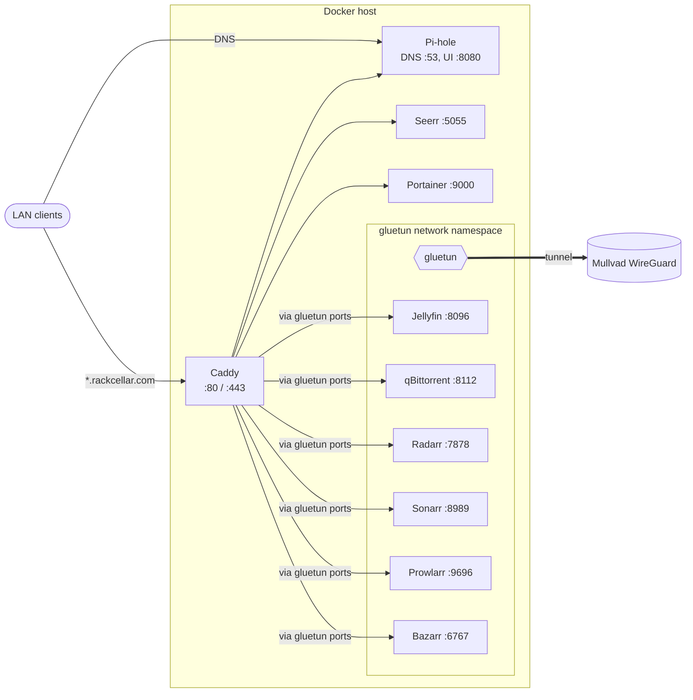

# Homelab

Single Docker Compose project (`homelab`) running DNS, a reverse proxy, and a VPN-routed media stack.

## Architecture



## Services

| Service     | URL                               | Behind VPN |
| ----------- | --------------------------------- | ---------- |
| Pi-hole     | `pihole.rackcellar.com` (`:8080`) | no         |
| Jellyfin    | `jellyfin.rackcellar.com`         | yes        |
| qBittorrent | `torrent.rackcellar.com`          | yes        |
| Radarr      | `radarr.rackcellar.com`           | yes        |
| Sonarr      | `sonarr.rackcellar.com`           | yes        |
| Prowlarr    | `prowlarr.rackcellar.com`         | yes        |
| Bazarr      | `bazarr.rackcellar.com`           | yes        |
| Seerr       | `seerr.rackcellar.com`            | no         |
| Portainer   | `portainer.rackcellar.com`        | no         |
| Vaultwarden | `vault.rackcellar.com`            | no         |

Services behind the VPN use `network_mode: service:gluetun`, so their ports are published on `gluetun`. They restart with it (`depends_on` with `restart: true`).

## Setup

Requires Docker Compose 2.17 or newer.

1. Create the env file and fill it in:

   ```sh
   cp .env.example .env
   ```

   | Variable                | Required | Description                                                                 |
   | ----------------------- | -------- | --------------------------------------------------------------------------- |
   | `WIREGUARD_PRIVATE_KEY` | yes      | Mullvad WireGuard private key                                               |
   | `WIREGUARD_ADDRESSES`   | yes      | Mullvad WireGuard address                                                   |
   | `PIHOLE_PASSWORD`       | yes      | Pi-hole web UI password                                                     |
   | `MEDIA_ROOT`            | no       | Media library root, default `/mnt/storage` (needs a `downloads/` subfolder) |

2. Start everything from the repo root:

   ```sh
   docker compose up -d
   ```

3. Point the router's DNS (or individual clients) at the host, and add a Pi-hole local DNS record for each `*.rackcellar.com` name pointing at the host IP.

## Layout

| Path                                            | Purpose                                                 |
| ----------------------------------------------- | ------------------------------------------------------- |
| `docker-compose.yml`                            | All services                                            |
| `caddy/Caddyfile`                               | Reverse proxy routes (wildcard `*.rackcellar.com` cert) |
| `media-stack/`, `pihole/etc-*`, `caddy/caddy_*` | Runtime state, git-ignored                              |
| `.env`                                          | Secrets, git-ignored                                    |

## Vaultwarden

`vault.rackcellar.com` is served by Caddy with a real Let's Encrypt cert (DNS-01 via Cloudflare), so no CA trust is needed on clients. The name has no public DNS record; it only resolves through Pi-hole.

1. Create a Cloudflare API token (`Zone:DNS:Edit`, scoped to `rackcellar.com`) and set `CF_API_TOKEN` in `.env`.
2. Add a Pi-hole local DNS record: `vault.rackcellar.com` -> host LAN IP.
3. Build and start: `docker compose up -d --build caddy vaultwarden`.
4. Set `VAULTWARDEN_SIGNUPS_ALLOWED=true`, recreate `vaultwarden`, create your account, then remove it and recreate again.
5. Away from home: on the host run `tailscale up --advertise-routes=192.168.68.0/24`, approve the route in the Tailscale admin console, and add Pi-hole as a Tailscale DNS nameserver restricted (split DNS) to `rackcellar.com`.

Backups: `vaultwarden-backup` writes a consistent `db-YYYY-MM-DD.sqlite3` snapshot daily (30 days kept) to `VAULTWARDEN_BACKUP_DIR` (default `./vaultwarden/backups`, same disk). Point it at another disk, and copy it offsite (e.g. `rclone` to B2/S3). To restore, stop `vaultwarden` and copy a snapshot over `vaultwarden/data/db.sqlite3`.

## Offsite backup

`scripts/backup.sh` backs up configs (not media) to Cloudflare R2 with restic: `.env`, `media-stack/` (minus caches, `MediaCover`, Jellyfin metadata), Pi-hole `pihole.toml` and `gravity.db`, Vaultwarden data, and the daily Vaultwarden snapshots. It briefly stops the apps with live SQLite databases (Pi-hole keeps running), keeps 7 daily, 4 weekly and 6 monthly snapshots, and creates the repository on first run.

1. Fill in the `R2_*` and `RESTIC_*` variables in `.env`. Keep `RESTIC_PASSWORD` somewhere off this machine; without it nothing can be restored.
2. Run it once by hand: `./scripts/backup.sh`.
3. Schedule it, for example `30 4 * * * cd ~/docker && ./scripts/backup.sh 2>&1 | logger -t homelab-backup` in `crontab -e`.

Restore: `docker run --rm -it -e RESTIC_REPOSITORY -e RESTIC_PASSWORD -e AWS_ACCESS_KEY_ID=<key> -e AWS_SECRET_ACCESS_KEY=<secret> -e AWS_DEFAULT_REGION=auto -v /tmp/restore:/restore restic/restic:0.18.0 restore latest --target /restore`.

## Verifying the VPN

Gluetun adds an iptables kill switch: its `OUTPUT` policy is `DROP`, and it only allows the Docker and LAN subnets (`FIREWALL_OUTBOUND_SUBNETS`), the Mullvad endpoint, and `tun0`. Containers using `network_mode: service:gluetun` share that namespace, so if the tunnel drops their traffic is blocked, not sent out over the normal connection.

To check it from the Docker host:

```sh
curl -s https://am.i.mullvad.net/ip                                  # host's real IP
docker exec qbittorrent wget -qO- https://am.i.mullvad.net/json      # should show mullvad_exit_ip: true
docker exec gluetun iptables -S OUTPUT                               # policy DROP, no rule for eth0 to the internet
docker logs gluetun 2>&1 | grep -E 'Public IP|leak check'
```

The two IPs must differ. DNS inside the namespace goes through gluetun's own resolver, and its upstream queries leave through the tunnel.

## Notes

- Caddy serves every `*.rackcellar.com` host with one wildcard Let's Encrypt cert (DNS-01 via Cloudflare); no client CA setup is needed. Unknown hosts are dropped.
- Jellyfin reserves an Nvidia GPU; remove its `deploy` block on a host without one.
- Image versions are pinned in `docker-compose.yml` and bumped by Renovate pull requests (`renovate.json`). Gluetun is pinned by digest because the deployed build is newer than the latest release tag.
