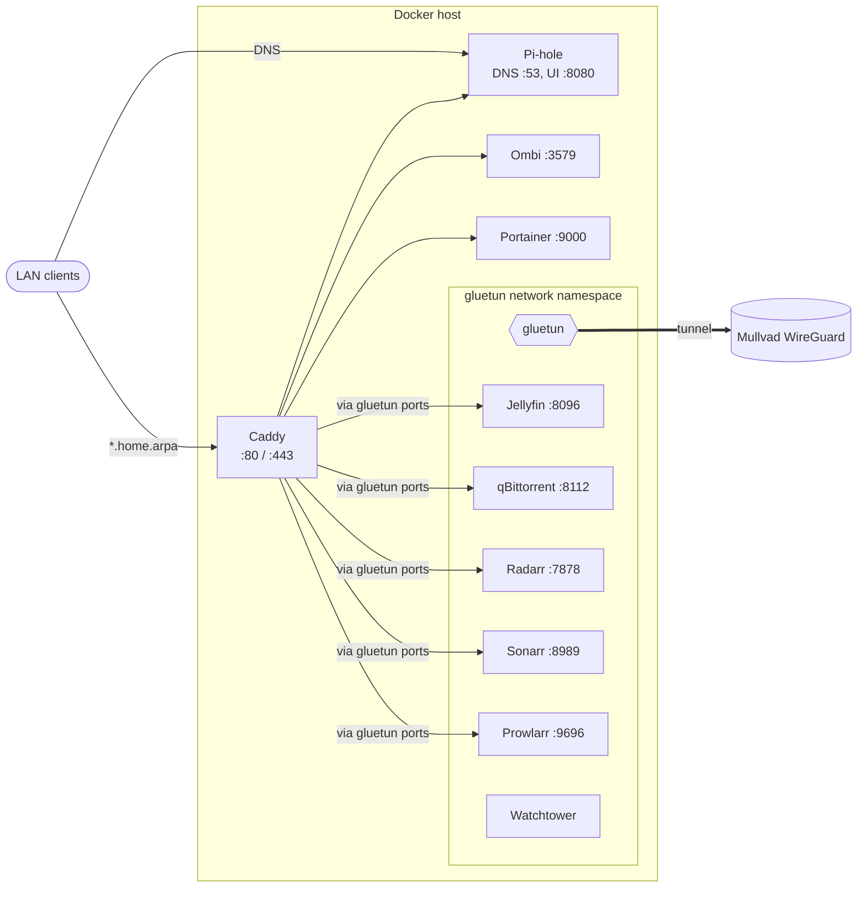

# Homelab

Single Docker Compose project (`homelab`) running DNS, a reverse proxy, and a VPN-routed media stack.

## Architecture



## Services

| Service     | URL                          | Behind VPN |
| ----------- | ---------------------------- | ---------- |
| Pi-hole     | `pihole.home.arpa` (`:8080`) | no         |
| Jellyfin    | `jellyfin.home.arpa`         | yes        |
| qBittorrent | `torrent.home.arpa`          | yes        |
| Radarr      | `radarr.home.arpa`           | yes        |
| Sonarr      | `sonarr.home.arpa`           | yes        |
| Prowlarr    | `prowlarr.home.arpa`         | yes        |
| Ombi        | `ombi.home.arpa`             | no         |
| Portainer   | `portainer.home.arpa`        | no         |
| Watchtower  | (none)                       | yes        |

Services behind the VPN use `network_mode: service:gluetun`, so their ports are published on `gluetun`. They restart with it (`depends_on` with `restart: true`).

## Setup

Requires Docker Compose 2.17 or newer.

1. Create the env file and fill it in:

   ```sh
   cp .env.example .env
   ```

   | Variable                | Required | Description                                                                 |
   | ----------------------- | -------- | --------------------------------------------------------------------------- |
   | `WIREGUARD_PRIVATE_KEY` | yes      | Mullvad WireGuard private key                                               |
   | `WIREGUARD_ADDRESSES`   | yes      | Mullvad WireGuard address                                                   |
   | `PIHOLE_PASSWORD`       | yes      | Pi-hole web UI password                                                     |
   | `MEDIA_ROOT`            | no       | Media library root, default `/mnt/storage` (needs a `downloads/` subfolder) |

2. Start everything from the repo root:

   ```sh
   docker compose up -d
   ```

3. Point the router's DNS (or individual clients) at the host, and add a Pi-hole local DNS record for each `*.home.arpa` name pointing at the host IP.

## Layout

| Path                                            | Purpose                                           |
| ----------------------------------------------- | ------------------------------------------------- |
| `docker-compose.yml`                            | All services                                      |
| `caddy/Caddyfile`                               | Reverse proxy routes (`local_certs`, internal CA) |
| `media-stack/`, `pihole/etc-*`, `caddy/caddy_*` | Runtime state, git-ignored                        |
| `.env`                                          | Secrets, git-ignored                              |

## Notes

- Caddy uses its internal CA; trust its root certificate (`caddy/caddy_data/caddy/pki/authorities/local/root.crt`) on clients to avoid browser warnings.
- Jellyfin reserves an Nvidia GPU; remove its `deploy` block on a host without one.
- Watchtower updates all images daily, and most are on `latest`.
